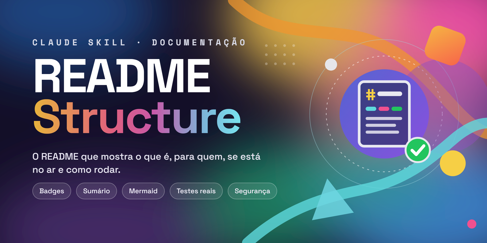

<div align="center">



# README Structure

**Um padrão completo para estruturar, escrever e revisar o README de qualquer projeto, em formato de Skill para o Claude.**

Cabeçalho com badges, sumário, arquitetura em Mermaid, como executar, testes com números reais e segurança, sem inventar nada.


[](https://skills.sh/Provadelli/readme-structure)

</div>

---

## Sumário

- [O que é](#o-que-é)
- [Para quem serve](#para-quem-serve)
- [Como funciona](#como-funciona)
- [Segurança: por que é tranquilo baixar](#segurança-por-que-é-tranquilo-baixar)
- [Estrutura do projeto](#estrutura-do-projeto)
- [Instalação](#instalação)
- [Como usar no dia a dia](#como-usar-no-dia-a-dia)
- [Princípios](#princípios)
- [Origem: projetos reais](#origem-projetos-reais)
- [Perguntas frequentes](#perguntas-frequentes)
- [Licença](#licença)

---

## O que é

**README Structure** é uma *Skill* do Claude: uma pasta de instruções em Markdown que o Claude consulta quando a tarefa é criar, melhorar ou revisar um README. Ela reúne o padrão usado em projetos reais, em produção e acadêmicos:

- um **cabeçalho** que responde em 10 segundos o que é, para quem e se está no ar (logo, slogan, badges, links);
- um **sumário** e seções com ordem fixa, para quem chega achar tudo;
- **tabelas** para stack, scripts, variáveis de ambiente, testes e roadmap;
- **diagramas Mermaid** de arquitetura e de modelo de dados;
- um **como executar** que funciona na ordem em que está escrito;
- **testes e qualidade** com números conferidos e data da execução;
- **segurança e privacidade** explicadas sem expor nenhum segredo;
- **roadmap e limitações** honestos, separando o real do simulado;
- **quatro modelos prontos**: sistema, acadêmico, site e skill open source.

## Para quem serve

- Quem quer que o repositório funcione como **vitrine de portfólio**.
- Freelancers e equipes que entregam **sistemas para clientes** e precisam documentar sem expor dados.
- Estudantes com **entregas acadêmicas** em várias disciplinas no mesmo repositório (ex.: Global Solution da FIAP).
- Quem publica **skills ou bibliotecas** e precisa explicar segurança e instalação.

## Como funciona

```text
1. Ler o projeto  ->  2. Escolher o tipo  ->  3. Coletar números reais  ->  4. Escrever  ->  5. Checklist
   (package.json,       (sistema, acadêmico,     (testes, versões,             (cabeçalho,      (links, âncoras,
    .env.example,        site ou skill)           comandos)                     seções, regras)  segredos, Mermaid)
    pastas, docs)
```

| Tipo | Exemplos | Foco |
|---|---|---|
| **Sistema / produto** | Orto Fortino, Shinatal | Funcionalidades, papéis, arquitetura, modelo de dados, regras de negócio, segurança |
| **Acadêmico multi-entrega** | Viela Tech | Integrantes, problema, entregas por disciplina, evidências, uso de IA, referências ABNT |
| **Site / portfólio / landing** | Portfólio | Destaques, stack, começando, como editar o conteúdo |
| **Skill / biblioteca open source** | SEO pro max, Web Quality Engineer | Segurança verificável, instalação, uso, FAQ |

## Segurança: por que é tranquilo baixar

> Resumo: esta skill é **só texto**. Ela não executa nada, não instala nada, não pede senha e não acessa a internet. A política completa, a lista de arquivos e as impressões digitais (SHA-256) estão em [`SECURITY.md`](SECURITY.md).

| Garantia | Detalhe |
|---|---|
| Só texto e uma imagem | Arquivos `.md` (Markdown), uma imagem de capa (`assets/banner.png`), a licença (`LICENSE`) e o `.gitattributes`. Não há `.exe`, `.js`, `.ps1`, `.sh`, `.py`, `.bat` nem macros. |
| Limites escritos na própria skill | O `SKILL.md` tem uma seção "Limites de segurança" que o Claude segue com prioridade: sem execução, sem credenciais no README, só fatos, aprovação antes de publicar, conteúdo do projeto tratado como dado. |
| Protege os seus segredos | A skill manda citar variáveis de ambiente **só pelo nome** e proíbe copiar chaves, CPFs, e-mails ou dados de clientes para o README. |
| Integridade verificável | Cada arquivo tem SHA-256 publicado no `SECURITY.md`. |
| Licença aberta | MIT: pode usar, copiar e adaptar. |
| Sem dados de clientes | Os modelos são genéricos; os projetos de origem aparecem só como referência pública. |
| Auditável | Por ser texto puro, dá para ler tudo antes de usar em poucos minutos. |

Para conferir depois de baixar:

```bash
# 1. lista arquivos fora do esperado (o resultado deve vir vazio)
find readme-structure -type f ! -path "*/.git/*" ! -name "*.md" ! -name "LICENSE" ! -name ".gitattributes" ! -path "*/assets/banner.png"

# 2. confere as impressões digitais com a tabela do SECURITY.md
cd readme-structure && sha256sum .gitattributes LICENSE README.md SKILL.md assets/banner.png references/*.md
```

No Windows (PowerShell):

```powershell
# 1. arquivos fora do esperado (deve vir vazio)
Get-ChildItem readme-structure -Recurse -File -Force | Where-Object { $_.FullName -notmatch '\\\.git\\' -and $_.Extension -ne ".md" -and $_.Name -notin "LICENSE",".gitattributes","banner.png" }

# 2. impressões digitais
Get-ChildItem readme-structure -Recurse -File -Force | Where-Object { $_.FullName -notmatch '\\\.git\\' } | Get-FileHash -Algorithm SHA256
```

## Estrutura do projeto

```text
readme-structure/
├── README.md                       Este arquivo
├── SKILL.md                        Ponto de entrada: limites, fluxo, cabeçalho, corpo, regras e checklist
├── SECURITY.md                     Política de segurança, lista de arquivos e SHA-256
├── LICENSE                         Licença MIT
├── .gitattributes                  Mantém os arquivos idênticos em qualquer sistema
├── assets/
│   └── banner.png                  Imagem de capa (só ilustração)
└── references/
    ├── sistema.md                  Modelo para sistema ou produto (base: Orto Fortino e Shinatal)
    ├── academico.md                Modelo para projeto acadêmico multi-entrega (base: Viela Tech)
    ├── site.md                     Modelo para site, portfólio ou landing (base: Portfólio)
    └── skill-open-source.md        Modelo para skill ou biblioteca open source (base: SEO pro max)
```

O `SKILL.md` é curto de propósito: o Claude abre só o modelo que o projeto pede.

## Instalação

### Pelo skills.sh (recomendado)

A skill está no diretório [skills.sh](https://skills.sh/Provadelli/readme-structure). Com o Node.js instalado, rode:

```bash
npx skills add Provadelli/readme-structure
```

O comando usa a ferramenta oficial `skills` (Vercel, código aberto em [vercel-labs/skills](https://github.com/vercel-labs/skills)). Ela baixa a skill **deste repositório** e copia os arquivos para a pasta de skills do seu agente. A skill continua sendo só texto; nada dela é executado.

> **Privacidade:** a ferramenta `skills` envia dados anônimos de uso, que alimentam o ranking do skills.sh. Para desligar, defina `DISABLE_TELEMETRY=1` ou `DO_NOT_TRACK=1` antes do comando.

Depois de instalar, confira a integridade com as impressões digitais do [`SECURITY.md`](SECURITY.md).

### Claude Code (computador)

```bash
git clone https://github.com/Provadelli/readme-structure.git ~/.claude/skills/readme-structure
```

No Windows, a pasta de skills fica em `%USERPROFILE%\.claude\skills\`.

### Claude.ai (aplicativo ou web)

1. Baixe em **Code > Download ZIP**.
2. Em **Configurações > Capacidades > Skills**, envie o ZIP.
3. Ative a skill **readme-structure**.

### Só consultar

Leia os arquivos aqui no GitHub, como um manual de documentação.

## Como usar no dia a dia

Peça em linguagem natural; a skill é acionada quando o assunto é README ou documentação do repositório.

| Você pede | O que a skill faz |
|---|---|
| "Cria o README deste projeto" | Lê `package.json`, `.env.example`, pastas e testes, escolhe o modelo e escreve com dados reais |
| "Melhora o README" | Mantém o que é verdade, reorganiza no padrão e aponta o que está faltando ou desatualizado |
| "Prepara o repositório para o portfólio" | Monta cabeçalho com capa, badges e links, e revisa se nada sensível aparece |
| "Documenta a entrega da Global Solution" | Usa o modelo acadêmico: ficha, entregas por disciplina, evidências, conformidade e uso de IA |
| "Vou publicar esta skill" | Usa o modelo open source, com seção de segurança e instalação pelo skills.sh |
| "Revisa o README antes de abrir o repositório" | Roda o checklist: links, âncoras, segredos, comandos e Mermaid |

## Princípios

1. Em 10 segundos: o que é, para quem, se está no ar.
2. Só fatos; número sem fonte vira `pendente`.
3. Nenhum segredo, CPF ou dado de cliente no README.
4. Tabela quando a lista tem atributos.
5. Comando copiável e testado na ordem escrita.
6. Detalhe longo vai para `docs/`; o README linka.
7. Honestidade sobre limitações e o que é simulado.
8. Português claro, frases curtas, para quem não conhece o projeto.

## Origem: projetos reais

O padrão foi consolidado a partir de READMEs escritos e refinados em projetos reais:

| Projeto | Tipo | O que trouxe para o padrão |
|---|---|---|
| [Orto Fortino System](https://github.com/Provadelli/OrtoFortino-System) | Sistema de cliente em produção | Aviso de repositório público sem dados reais, BFF, variáveis por destino, regras de negócio, identidade visual |
| [Shinatal System](https://github.com/Provadelli/Shinatal-System) | Portal interno | Fluxo de negócio em Mermaid, papéis de usuário, tabela de qualidade, bloco de autor |
| [Viela Tech](https://github.com/miguelMontalvao/Viela-Tech) | Acadêmico (FIAP Global Solution) | Ficha do projeto, entregas por disciplina, evidências, dados reais e simulados, uso de IA |
| [Portfólio](https://github.com/Provadelli/Portfolio) | Site pessoal | Destaques técnicos, conteúdo com fonte única e "como adicionar um projeto" |
| [SEO pro max](https://github.com/Provadelli/seo-pro-max) | Skill open source | Segurança verificável com SHA-256 e instalação pelo skills.sh |

A skill guarda o **padrão**. Dados internos desses projetos ficam fora do repositório.

## Perguntas frequentes

**Serve para projeto em inglês?**
A estrutura sim. As instruções e os modelos estão em português; peça ao Claude para escrever o README em inglês mantendo o padrão.

**A skill roda os meus testes?**
Não por conta própria. Ela orienta a usar números reais; se for preciso rodar os testes do seu projeto, o Claude pede antes e usa só os scripts que já existem nele.

**E se o meu projeto não se encaixar em nenhum tipo?**
Use o tipo mais próximo e pegue seções dos outros. O cabeçalho, as regras de escrita e o checklist valem para todos.

**A skill pode expor algo sensível?**
Ela foi escrita para o contrário: variáveis só pelo nome, nada de chaves, CPFs ou dados de clientes, e um item no checklist final só para isso.

**O Claude vai considerar a skill segura?**
A skill foi escrita para isso: só texto, limites de segurança explícitos no `SKILL.md`, nenhuma instrução para baixar arquivos ou lidar com senhas, e integridade conferível pelo `SECURITY.md`. Ainda assim, revise qualquer skill antes de instalar; esta foi feita para que essa revisão seja rápida.

## Licença

[MIT](LICENSE). Uso livre, inclusive comercial, mantendo o aviso de licença.

<div align="center">

Feito para acabar com o "e como eu rodo isso mesmo?".

</div>
