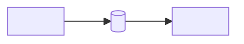

# Modelo: projeto acadêmico multi-entrega

Base: Viela Tech (FIAP, Global Solution, várias disciplinas em um repositório, cada uma com sua pasta e seu README).

O avaliador precisa achar **cada entrega e cada requisito** rápido. Por isso: ficha logo no começo, tabela de links da entrega, tabela de entregas por disciplina e matriz de conformidade.

Substitua tudo entre `<>`.

````md
<div align="center">

<picture>
  <source media="(prefers-color-scheme: dark)" srcset="<caminho>/logo-escuro.svg">
  /logo.svg" alt="<Nome>, <descritor>" width="360" />
</picture>

### <Slogan>

<O que é> para **<problema e lugar>**. <Como funciona em uma frase, do ponto de vista de quem usa.>

[](<url>)


[Aplicação](<url>) · [Simulação](<url>) · [Arquitetura](docs/arquitetura.md) · [Conformidade](docs/matriz-de-conformidade.md) · [Integrantes](Integrantes.md)

<br/>

/og-image.jpg" alt="<descrição>" width="860" />

<br/>

**<Instituição> · <Curso> · <Entrega>: <tema> · Turma <turma>**

</div>

---

## Visão geral

<Problema em 2 ou 3 frases, com o número que dá a dimensão em negrito e a fonte.>

O <Nome> liga **<parte A>** a **<parte B>**, em três passos:

1. **<Verbo>:** <o que acontece>.
2. **<Verbo>:** <o que acontece>.
3. **<Verbo>:** <o que acontece>.

> <O que o projeto NÃO faz, se houver risco de leitura errada.>

<Tabela de 3 colunas, uma por persona, com ícone e 3 bullets cada (HTML <table> com td width="33%" valign="top").>

## Ficha do projeto

| Campo | Resposta |
|---|---|
| **Nome** | |
| **Local** | |
| **Público beneficiado** | |
| **Problema, em uma frase** | |
| **Como funciona** | |
| **O que cada parte faz** | **<Parte>:** <papel>.<br>**<Parte>:** <papel>. |
| **Link do repositório** | |
| **Indicador de impacto** | |
| **ODS conectados** | |

**Links da entrega:**

| | |
|---|---|
| Aplicação web | <url> |
| <Simulação / canal / vídeo> | <url ou "pendente (ver pasta)"> |

## Sumário

1. [Integrantes](#1-integrantes)
2. [Problema](#2-problema)
3. [Público beneficiado](#3-público-beneficiado)
4. [Solução](#4-solução)
5. [Como funciona](#5-como-funciona)
6. [Arquitetura](#6-arquitetura)
7. [Entregas por disciplina](#7-entregas-por-disciplina)
8. [Estrutura do repositório](#8-estrutura-do-repositório)
9. [Como executar](#9-como-executar)
10. [Testes](#10-testes)
11. [Evidências](#11-evidências)
12. [Segurança e privacidade](#12-segurança-e-privacidade)
13. [Dados reais e simulados](#13-dados-reais-e-simulados)
14. [Impacto e ODS](#14-impacto-e-ods)
15. [Limitações e roadmap](#15-limitações-e-roadmap)
16. [Uso de IA e referências](#16-uso-de-ia-e-referências)

---

## 1. Integrantes

| Nome | RM |
|---|---|
| <Nome completo> | <RM> |

Responsabilidades em [`Integrantes.md`](Integrantes.md).

## 2. Problema

<Contexto, número com fonte, e "**Em uma frase:** ...".>

## 3. Público beneficiado

- **<Persona>:** <o que ganha>.

## 4. Solução

1. <Passo numerado, ligando as partes do projeto.>

## 5. Como funciona

| Passo | O que acontece | Onde |
|---|---|---|
| 1 | | `<pasta>/` |

## 6. Arquitetura



**Stack:**

- **<Parte>:** <tecnologias>.

## 7. Entregas por disciplina

| # | Disciplina | Pasta | O que entrega |
|---|---|---|---|
| 1 | <Disciplina> | [`01-<pasta>/`](01-<pasta>/README.md) | <entregáveis com números: N testes, PDF de N páginas> |

O status de cada requisito está em [`docs/matriz-de-conformidade.md`](docs/matriz-de-conformidade.md).

## 8. Estrutura do repositório

```text
<repo>/
├── 01-<pasta>/      <conteúdo>
├── docs/            arquitetura e matriz de conformidade
├── AI.md            registro do uso de IA
├── Integrantes.md   equipe, RMs e responsabilidades
└── README.md        este arquivo
```

<Explique a numeração das pastas se ela não for óbvia.>

## 9. Como executar

**Pré-requisitos:** <versões>.

```bash
# 1 · <Parte>
cd <pasta>
<comando>            # <o que faz>
```

## 10. Testes

Execução de <dd/mm/aaaa>:

| Módulo | Comando | Resultado |
|---|---|---|
| <Módulo> | `<comando>` | <N> de <N> passaram |

## 11. Evidências

| <Evidência A> | <Evidência B> |
|---|---|
|  |  |

## 12. Segurança e privacidade

- **<Controle>:** <como funciona>.
- **LGPD:** <consentimento (art. 11, I), exclusão (art. 18), coleta mínima>.
- **Segredos:** nenhuma chave no código; `.env` ignorado pelo git.

## 13. Dados reais e simulados

| Dado | Origem | Situação |
|---|---|---|
| <Dado> | <fonte> | **real** / simulado / gerado por IA |

## 14. Impacto e ODS

- **Indicador de impacto:** <métrica mensurável>.
- **ODS <n> (<nome>):** <ligação concreta>.

## 15. Limitações e roadmap

**Limitações atuais:**

- <limitação real>

**Próximos passos:**

1. <passo>

## 16. Uso de IA e referências

O uso de IA (<ferramentas>), com os prompts e a forma de validação, está registrado em [`AI.md`](AI.md).

**Referências** (ABNT):

- SOBRENOME, Nome. *Título*. Veículo, data. [link](<url>).
````
