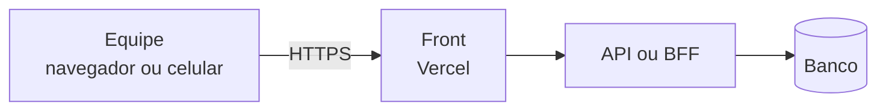
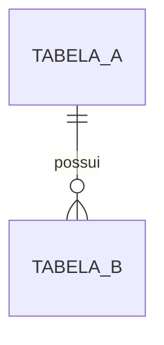

# Modelo: sistema / produto

Base: Orto Fortino (sistema de cliente em produção) e Shinatal (portal interno com papéis de usuário).

Substitua tudo entre `<>`. Remova as seções que não se aplicam (sem banco, sem Modelo de dados; sem papéis, sem Papéis de usuário).

````md
<div align="center">

.svg" alt="<Nome>, <descritor>" width="320" />

### <Slogan curto: o benefício em uma linha>

Sistema de <tipo> para a **<cliente ou público>**: <3 ou 4 capacidades principais, separadas por vírgula>.


[Acessar a plataforma](<url>) · [Vídeo de apresentação](docs/video/<arquivo>.mp4) · [Arquitetura](docs/arquitetura.md) · [Segurança](SECURITY.md)

<br/>

.webp" alt="<O que a tela mostra>" width="860" />

</div>

---

> **Este repositório é público e não contém dados reais.** <Onde os dados ficam e como são protegidos.> Os dados usados em testes e no vídeo são fictícios.

## Sumário

1. [Visão geral](#1-visão-geral)
2. [Funcionalidades](#2-funcionalidades)
3. [Papéis de usuário](#3-papéis-de-usuário)
4. [Arquitetura](#4-arquitetura)
5. [Stack](#5-stack)
6. [Modelo de dados](#6-modelo-de-dados)
7. [Regras de negócio](#7-regras-de-negócio)
8. [Identidade visual](#8-identidade-visual)
9. [Como executar](#9-como-executar)
10. [Testes e qualidade](#10-testes-e-qualidade)
11. [Segurança e privacidade](#11-segurança-e-privacidade)
12. [Estrutura do repositório](#12-estrutura-do-repositório)
13. [Roadmap](#13-roadmap)
14. [Convenções](#14-convenções)
15. [Autor](#15-autor)
16. [Licença](#16-licença)

---

## 1. Visão geral

<Quem usa, quantas pessoas, o que substitui (papel, planilha), onde roda (computador, celular).>

| Módulo | Objetivo |
|---|---|
| **<Módulo>** | <Objetivo em uma frase> |

<Se a regra central for um cálculo ou fluxo de negócio, um flowchart dele aqui, como no Shinatal.>

## 2. Funcionalidades

**<Módulo>**
- [x] <Funcionalidade concreta>
- [ ] <Planejada>

## 3. Papéis de usuário

| Papel | Acesso |
|---|---|
| **<Papel>** | <O que vê e o que pode alterar> |

## 4. Arquitetura



- **<Camada>:** <responsabilidade e a decisão importante>.

Detalhes e decisões: [`docs/arquitetura.md`](docs/arquitetura.md).

## 5. Stack

| Camada | Tecnologia |
|---|---|
| Front-end | |
| Estilo | |
| Rotas e dados | |
| Back-end | |
| Qualidade | |
| Deploy | |

## 6. Modelo de dados



| Tabela | Descrição |
|---|---|
| `<tabela>` | <conteúdo> |

O esquema é versionado em [`<pasta de migrações>/`](<pasta>).

## 7. Regras de negócio

1. **<Regra em negrito>**, <consequência prática>.

## 8. Identidade visual

| Token | Cor | Uso |
|---|---|---|
| `<token>` | `#000000` | <uso> |

**Fontes:** <títulos> e <texto>. Arquivos da marca em [`docs/marca/`](docs/marca/).

## 9. Como executar

**Pré-requisitos:** <runtime e versão> e <serviços externos>.

```bash
git clone https://github.com/<usuario>/<repo>.git
cd <repo>
npm install
cp .env.example .env.local     # preencha com as chaves do SEU projeto
npm run dev                    # http://localhost:<porta>
```

| Script | Descrição |
|---|---|
| `npm run dev` | Servidor de desenvolvimento |
| `npm run build` | Build de produção |
| `npm test` | Testes unitários |

**Variáveis de ambiente** (modelo em [`.env.example`](.env.example)):

| Variável | Onde vai | Observação |
|---|---|---|
| `<VAR_PUBLICA>` | Navegador | Pública; protegida por <RLS/regras> |
| `<VAR_SECRETA>` | Servidor | **Secreta.** Nunca no navegador nem no git |

> **Atenção:** o `.env.local` é ignorado pelo git. Nunca versione chaves reais.

## 10. Testes e qualidade

Execução de <dd/mm/aaaa>:

| Tipo | Comando | Resultado |
|---|---|---|
| Unitários | `npm test` | <N> de <N> passaram: <o que cobrem> |
| Ponta a ponta | `npm run test:e2e` | <fluxos> |
| Acessibilidade | <ferramenta> | <resultado> |

<Se houver e2e: "Rode apenas contra um ambiente de desenvolvimento, nunca contra produção.">

## 11. Segurança e privacidade

**Acesso**
- <login, MFA, sessão, sem cadastro público>

**Dados**
- <RLS ou regras, mascaramento, auditoria, consentimento LGPD>

**Navegador**
- <CSP e cabeçalhos>

**Segredos**
- <onde ficam, varredura no pre-commit>

Para reportar uma vulnerabilidade, veja [`SECURITY.md`](SECURITY.md).

## 12. Estrutura do repositório

```text
<repo>/
├── src/                <o que tem>
├── docs/               <o que tem>
├── .env.example        modelo das variáveis (sem segredos)
└── README.md
```

## 13. Roadmap

| Fase | Entrega | Status |
|---|---|---|
| 0 | <entrega> | ✅ |
| 1 | <entrega> | em andamento |

**Próximos passos:** <lista curta>.

## 14. Convenções

- Commits em português, no padrão [Conventional Commits](https://www.conventionalcommits.org/pt-br)
- Branches: `feat/<nome>` e `fix/<nome>`
- Código em inglês e textos da interface em português

## 15. Autor

<table>
<tr>
<td align="center" width="160">
<a href="https://github.com/<usuario>">.png" width="96" alt="<Nome>" /></a><br/>
<b><Nome></b><br/>
<sub><a href="https://github.com/<usuario>">@<usuario></a></sub>
</td>
<td>

**<Papel no projeto.>**

<O que fez, em duas linhas.>

</td>
</tr>
</table>

## 16. Licença

<Licença. Se "todos os direitos reservados": o código está público só para consulta e portfólio.> A marca pertence a <dono>.
````
